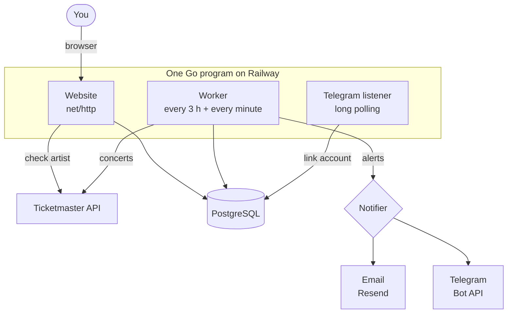

<p align="center">
  
</p>

<h1 align="center">Soundcheck</h1>

<p align="center">
  <strong>Never miss the show.</strong><br>
  Soundcheck watches Ticketmaster for the artists you follow and tells you,<br>
  by email or Telegram, the moment they announce a concert in your city.
</p>

<p align="center">
  <a href="https://getsoundcheck.cc"></a>
  
  
  
  <a href="LICENSE"></a>
</p>

---

## Why

Ticketmaster can tell you about an artist's shows, but only if you keep checking. Soundcheck does the checking for you: add the artists you like and your city once, and you'll hear about new concerts, ticket sales and changes without opening a single app.

I built it in a week to learn Go, using mostly the standard library: the web server, templates, OAuth and the background jobs are written from scratch.

## Features

- **Follow artists** — names are checked against Ticketmaster when you add them, so typos and made-up names are rejected and every artist is matched to the right Ticketmaster ID
- **Upcoming shows** — every concert of your artists in your city, soonest first, in the venue's local time, with ticket status (*On sale now*, *On sale Fri · 10:00*, *Cancelled*)
- **New show alerts** — a message as soon as an artist announces a concert in your city
- **On-sale reminders** — a day before and 15 minutes before public ticket sales start
- **Cancellation and new-date alerts** — if a show you might go to is cancelled, postponed or moved
- **Two channels** — email, plus Telegram if you connect the bot in one click
- **Your choice of alerts** — turn each kind of alert on or off in Settings
- **Accounts** — sign up with email and password, or with Google; change your email or password, or delete your account anytime
- **Verified emails** — a new account only works after you click the link sent to your inbox, so nobody can sign up with someone else's address and fill it with alerts
- **Retro UI** — the whole site looks like the classic Mac OS X Finder: sidebar, folders, windows with traffic lights

## How it works

One Go program runs the website, the worker and the Telegram listener side by side, each in its own goroutine:



1. **You add an artist.** The website asks Ticketmaster whether the artist exists, saves the canonical name and ID, and immediately checks that artist's concerts.
2. **The worker scans Ticketmaster.** Every 3 hours it goes through every artist anyone follows (each one once, no matter how many followers), five at a time, staying under Ticketmaster's rate limit.
3. **Each concert is saved once.** Saving a concert tells the worker what happened: *new*, *status changed* or *moved to a new date*.
4. **Alerts go out.** For each change the worker finds the followers in that city and hands one message to every channel. A second timer runs every minute and sends on-sale reminders.
5. **Nothing is sent twice.** Before sending, the worker records the alert in a `sent_alerts` table. If the same alert comes up again, the record is already there and it's skipped.

## Under the hood

| Area | How it's done |
|---|---|
| **Concurrency** | `errgroup` with a limit of 5 artists at once, `rate.Limiter` at 4 requests/s for Ticketmaster's 5/s limit, two `time.Ticker`s inside one `select` loop |
| **Shutdown** | `signal.NotifyContext` turns SIGTERM into a cancelled `context`; the worker stops between artists and `http.Server.Shutdown` lets open requests finish |
| **Change detection** | `INSERT … ON CONFLICT DO NOTHING` decides "new" in one atomic step, then old and new status/date are compared |
| **Alerts** | a `Notifier` interface with email and Telegram implementations; adding a channel doesn't touch the worker |
| **Time zones** | dates are stored in UTC with the venue's time zone and shown in local time; loaded zones are cached in a `sync.Map` |
| **Telegram linking** | Settings creates a one-time code, the bot link carries it to Telegram, and a long-polling goroutine matches `/start <code>` back to the account |
| **Auth** | bcrypt passwords with strength rules, random session tokens stored only as SHA-256 hashes, `HttpOnly` + `Secure` + `SameSite` cookies, Google OAuth with a `state` cookie |
| **Email verification** | sign-up sends a one-time link (hashed in the database, valid for 24 h, used up in a single `DELETE … RETURNING` statement); clicking it confirms the address and logs you in. Until then you can't log in and no alerts are emailed. A stranger's unconfirmed sign-up can't block the real owner, resends are limited to one a minute, and the page looks the same whether an email exists or not |
| **Account takeover** | linking Google to an account whose email was never confirmed removes that account's password, Telegram chat and sessions, so whoever registered someone else's address loses access ("pre-account takeover") |
| **Hardening** | server timeouts against slow clients, security headers, API keys kept out of logs, cleanup of expired sessions, links, unconfirmed sign-ups and old concerts |
| **Database** | PostgreSQL through `pgx`, its own schema on a shared instance, schema created and updated on startup |

## Tech stack

- **Go** — `net/http`, `html/template`, `embed`, `context`, goroutines, `golang.org/x/sync/errgroup`, `golang.org/x/time/rate`, `golang.org/x/crypto/bcrypt`
- **PostgreSQL** — `jackc/pgx/v5`
- **APIs** — Ticketmaster Discovery, Telegram Bot API, Resend, Google OAuth 2.0
- **Front end** — server-rendered HTML, hand-written CSS (no framework), a few lines of JavaScript
- **Infrastructure** — multi-stage Docker build, Railway, custom domain

## Project structure

```
cmd/
  soundcheck/      the app: wires everything together, starts the website, worker and bot
  search/          small command-line tool: search concerts for an artist in a city
internal/
  core/            shared types (Event, User, Artist) and time zone helpers
  ticketmaster/    Ticketmaster API client
  store/           everything that talks to PostgreSQL, including the schema
  worker/          background scans, alerts and on-sale reminders
  notify/          the Notifier interface, Telegram and email
  web/             routes, handlers, templates, CSS and JavaScript
```

## Running it yourself

You'll need Go, a PostgreSQL database and a free [Ticketmaster API key](https://developer.ticketmaster.com/).

```bash
cp .env.example .env      # fill in at least TICKETMASTER_API_KEY and DATABASE_URL
go run ./cmd/soundcheck   # http://localhost:8080
```

| Variable | Required | What it's for |
|---|---|---|
| `TICKETMASTER_API_KEY` | yes | concert data |
| `DATABASE_URL` | yes | PostgreSQL connection |
| `APP_BASE_URL` | for alerts and Google | the site's public address, e.g. `https://getsoundcheck.cc` |
| `RESEND_API_KEY`, `EMAIL_FROM` | for email | sending from a domain verified in Resend |
| `TELEGRAM_BOT_TOKEN`, `TELEGRAM_BOT_USERNAME` | for Telegram | the bot from @BotFather |
| `GOOGLE_CLIENT_ID`, `GOOGLE_CLIENT_SECRET` | for Google sign-in | an OAuth client from Google Cloud Console |

Every optional channel switches itself off when its variables are missing, so the site runs with just the first two.

The tables are created automatically on the first start. With Docker:

```bash
docker build -t soundcheck .
docker run --env-file .env -p 8080:8080 soundcheck
```

## What I learned

This was my first Go project, so it covers a lot of the language: packages and the `internal/` layout, structs, methods and interfaces (implicit, checked at compile time with `var _ Notifier = (*Telegram)(nil)`), errors as values with `%w` and `errors.Is/As`, goroutines and `context` for cancellation, `errgroup` and rate limiting, `select` with several tickers, `sync.Map` for shared state, closures for middleware, method values as callbacks, and `embed` to ship templates inside the binary.

## License

[MIT](LICENSE) © 2026 Vladislav Sakharov
